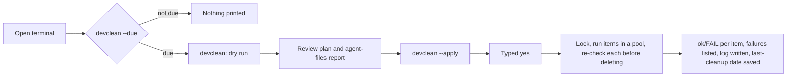

# Repo maintenance scripts

Node.js scripts for the folder that holds your git repos. They run on Windows (built for a Windows 365 Cloud PC), macOS and Linux. They need Node 18+ and git on PATH, and nothing else: no dependencies.

| Script | What it does | Default |
|---|---|---|
| `gpall.mjs` | `git pull --ff-only --prune` in every repo, in parallel | runs immediately (a refused pull changes nothing) |
| `nmclean.mjs` | deletes `node_modules` in every repo, including workspace packages | dry run |
| `nminstall.mjs` | lockfile-exact install: `npm ci`, `yarn install --frozen-lockfile` (Yarn 1) or `yarn install --immutable` (Yarn 2+) | dry run, one repo at a time |
| `devclean.mjs` | periodic cleanup: stale `node_modules`, old build outputs, old temp-folder entries, npm/Yarn 1 caches; review-only report of agent files | dry run |

`devkit-core.mjs` holds the shared safety checks and the plan → confirm → run flow of `nmclean`, `nminstall` and `devclean`. `gpall` is standalone: it deletes nothing, so it needs none of those checks. All four scripts share these conventions:

- an optional bare number sets the number of parallel jobs;
- an `ok`/`FAIL` line is printed per item as it finishes;
- failures are listed with details at the end;
- every item is attempted even after a failure;
- exit codes: `0` all ok, `1` some items failed, `2` refused before changing anything (including a mistyped option).

## Setup

Copy `gpall.mjs`, `nmclean.mjs`, `nminstall.mjs`, `devclean.mjs` and `devkit-core.mjs` into `~/scripts/`. The `*.test.mjs` files and `test-helpers.mjs` are only for running the tests. Then add these lines to your shell's startup file:

- Git Bash on Windows, and most Linux shells: `~/.bashrc`;
- macOS: `~/.zshrc`.

```bash
alias gpall='node ~/scripts/gpall.mjs'
alias nmclean='node ~/scripts/nmclean.mjs'
alias nminstall='node ~/scripts/nminstall.mjs'
alias devclean='node ~/scripts/devclean.mjs'
node ~/scripts/devclean.mjs --due   # one line at terminal start when a cleanup is due
```

Run the commands from your repos folder. Each script has `--help`. `nmclean`, `nminstall` and `devclean` only print a plan (a dry run); add `--apply` to act on it. If a script reports that there is no interactive terminal (Git Bash outside VS Code can do this), use the VS Code terminal or PowerShell, or add `--yes` after reviewing the dry run.

## Workflow

There is no scheduled task on purpose. A Cloud PC may be powered off when you are not connected, and an unattended job would delete files without anyone reviewing the plan. Instead, `--due` reminds you when you open a terminal, and you run the cleanup yourself.



## Safety model

These rules apply to `nmclean`, `nminstall` and `devclean`. `gpall` only runs `git pull`.

**Where scripts refuse to run** (exit 2, nothing changed):

- drive roots, the filesystem root and network (UNC) paths;
- your home folder;
- Windows: anything inside `SystemRoot`, `ProgramFiles`, `ProgramData`, `APPDATA` or `LOCALAPPDATA`;
- macOS and Linux: anything inside the system folders (`/usr`, `/etc`, `/opt`, `/System`, `/Library` and the like) or inside `~/Library`, `~/.cache`, `~/.config` or `~/.local`.

`/var` is not on the list, because macOS keeps each user's temp folder there.

**What may be deleted in a repo.** A folder is deleted only if all of these hold:

- its name is exactly an allow-listed one (`node_modules`, `.next`, `.turbo`, `.parcel-cache`, `coverage`, `dist`, `build`);
- it sits next to a `package.json`;
- git ignores it (one exception, under *Before each deletion*);
- it contains no tracked file (checked case-insensitively);
- it contains no nested `.git`.

The search never enters dot-folders (`.venv`, `.yarn`, …), `node_modules` or nested repos.

**Links.** Symlinks and junctions are removed as links. Their targets are never touched, and a folder reached through a link is never entered.

**Before each deletion:**

- every check runs again;
- the folder is renamed first, so a folder whose rename is refused (on Windows, usually a file in use) is skipped whole;
- a run interrupted after the rename leaves `<name>.devkit-deleting-<timestamp>` behind, which the next run finishes off.

The next run deletes such a leftover without the git-ignore check, because `.gitignore` no longer matches the new name. Every other check still applies, including "no tracked file".

macOS and Linux allow renaming and deleting files that are in use. There, a folder in use is deleted, and programs that still have its files open keep reading them until they close them.

**Temp folder** (`devclean` only). It must be where the system normally keeps it, or a subfolder:

- Windows: `%USERPROFILE%\AppData\Local\Temp`;
- macOS: `/private/var/folders` (each user's own temp folder) or `/private/tmp`;
- Linux: `/tmp` or `/var/tmp`.

Only top-level entries with nothing newer than the cutoff are deleted, each re-checked first. Links are kept. On macOS and Linux, entries owned by another user are kept too, since `/tmp` is shared.

**Process.** An `--apply` run holds one lock shared by the three scripts, so two of them never change files at the same time. A live run keeps refreshing the lock. Every action is logged to `%LOCALAPPDATA%\devkit\logs` on Windows and `~/.local/state/devkit/logs` elsewhere.

**Child processes:**

- they get no stdin and no inherited `GIT_*` variables, and credential prompts are disabled;
- git runs with fsmonitor disabled and no optional locks;
- npm/yarn run with the current folder excluded from the program search (on macOS and Linux, `PATH` keeps only absolute folders);
- on timeout, the command and every process it started are killed: with `taskkill` on Windows, and by listing them with `ps` elsewhere.

**Agent files are never deleted.** `devclean` lists untracked files per repo (where agent scratch files show up) and the size of `~/.claude`. Claude Code deletes its own session data after `cleanupPeriodDays` (default 30). Use `claude project purge <path> --dry-run` for projects you no longer use.

### One-time check on Windows

Junctions exist only on Windows, so the tests use directory symlinks in their place. Run this once in PowerShell before relying on the scripts on Windows:

```powershell
$t = "$env:USERPROFILE\devkit-smoke"
New-Item -ItemType Directory "$t\outside", "$t\work\app\node_modules\pkg" -Force | Out-Null
Set-Content "$t\outside\precious.txt" "keep me"
Set-Content "$t\work\app\node_modules\pkg\a.js" "x"
Set-Content "$t\work\app\package.json" "{}"
cmd /c mklink /J "$t\work\app\node_modules\linked" "$t\outside"
Set-Location "$t\work\app"; git init -q; Set-Content .gitignore "node_modules/"
Set-Location "$t\work"
node "$HOME\scripts\nmclean.mjs" --apply --yes
Test-Path "$t\outside\precious.txt"   # must be True
Test-Path "$t\work\app\node_modules"  # must be False
```

If the first `Test-Path` prints `False`, stop using the scripts and report the output.

## Decisions

**1. Node.js scripts instead of PowerShell or bash.**
*Context:* the scripts must work in Git Bash, PowerShell and cmd on Windows and in macOS and Linux shells, and handle junctions, long paths and child processes predictably.
*Decision:* plain `.mjs` with JSDoc types checked by `// @ts-check`, using only built-in modules.
*Consequences:* the scripts need nothing installed, and tests run with `node --test`. TypeScript's type checking works without a build step. Junction handling relies on Node's `lstat`, so it needs the one-time Windows check above.

**2. Shared core plus small scripts.**
*Context:* three scripts need the same safety checks and run flow; copying them risks the copies drifting apart.
*Decision:* `devkit-core.mjs` owns every check and the plan/confirm/run flow; each script only plans its items.
*Consequences:* safety fixes land in one place, but the scripts must be copied together.

**3. Dry run plus confirmation instead of a scheduled task.**
*Context:* unattended deletion is the main risk, and a Cloud PC may not be running at a scheduled time.
*Decision:* dry run by default, then `--apply` and a typed `yes`; `--due` only reminds.
*Consequences:* cleanup happens only when you look at it.

**4. Lockfile-exact installs only.**
*Context:* a bulk install must not change lockfiles or pick a package manager by guesswork.
*Decision:* `npm ci` / `--frozen-lockfile` / `--immutable`; ambiguous repos are skipped with the reason.
*Consequences:* repos without a lockfile need one manual install first.

## Checks

The scripts have no dependencies. `package.json` lists only the tools that check them: ESLint for lint and formatting, and TypeScript for types. These tools need Node 22 or later; the scripts themselves still run on Node 18.

```bash
npm install         # once, installs the check tools
npm run check       # lint, then type check, then tests
npm run format      # fix formatting and other auto-fixable lint findings
node --test         # tests only; needs no install
```

The house rules, each with its reason, are in `eslint.config.mjs`.

The tests pass on macOS and on Linux. They have not been run on Windows.

## Known limits

- **Not verified on Windows.** The tests can't reproduce these Windows behaviours:
  - junction handling (run the check above);
  - the `taskkill` tree kill;
  - whether a file in use always blocks the rename.
- OneDrive cloud-only files have not been tested. Keep repos outside OneDrive.
- Yarn 2+ caches are per project and may be committed to git, so they are never cleaned. pnpm and bun projects are skipped.

## Sources

- [npm ci](https://docs.npmjs.com/cli/v11/commands/npm-ci) and [npm cache](https://docs.npmjs.com/cli/v11/commands/npm-cache)
- [Yarn 1 install](https://classic.yarnpkg.com/en/docs/cli/install), [Yarn install (2+)](https://yarnpkg.com/cli/install), [Yarn cache clean (2+)](https://yarnpkg.com/cli/cache/clean)
- [Node.js April 2024 security release (CVE-2024-27980)](https://nodejs.org/en/blog/vulnerability/april-2024-security-releases-2)
- [Claude Code: the .claude directory](https://code.claude.com/docs/en/claude-directory.md)
- [Managing Windows 365 Flex](https://learn.microsoft.com/en-us/windows-365/enterprise/windows-365-flex-manage)
- [git pull](https://git-scm.com/docs/git-pull)
