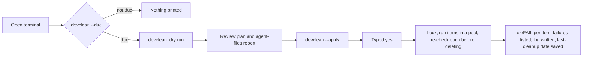

# Repo maintenance scripts

Node.js scripts for the folder that holds your git repos. They run on Windows (built for a Windows 365 Cloud PC), macOS and Linux. They need Node 18+ and git on PATH, and nothing else: no dependencies.

| Command | What it does | Default |
|---|---|---|
| `gpall` | `git pull --ff-only --prune` in every repo, in parallel | runs immediately (a refused pull changes nothing) |
| `nmclean` | deletes `node_modules` in every repo, including workspace packages | dry run |
| `nminstall` | lockfile-exact install: `npm ci`, `yarn install --frozen-lockfile` (Yarn 1) or `yarn install --immutable` (Yarn 2+) | dry run, one repo at a time |
| `devclean` | periodic cleanup: stale `node_modules`, old build outputs, old temp-folder entries, npm/Yarn 1 caches; review-only report of agent files | dry run |
| `npmrctoken` | puts a new registry token into the `_authToken=` line of every `.npmrc`, in repos and their package folders | dry run |

The folder holds:

- `index.mjs`: the one entry point. It starts a command by name: `node index.mjs nmclean --apply`.
- `lib/`: all code.
  - `lib/commands/`: one file per command. `lib/commands/index.mjs` lists them; a new command is one new file plus one line there.
  - `lib/shared/`: the shared code, one file per area. It holds the safety checks and the plan → confirm → run flow of `nmclean`, `nminstall`, `devclean` and `npmrctoken`, which import it only through `lib/shared/index.mjs`. `gpall` is standalone: it deletes nothing, so it needs none of those checks.
- `tests/`: the tests, in `tests/commands/` and `tests/shared/` like the code they test. `tests/setup.mjs` prepares a test run; `tests/utils.mjs` builds files, repos and links for tests.

All the commands share these conventions:

- an optional bare number sets the number of parallel jobs;
- an `ok`/`FAIL` line is printed per item as it finishes;
- failures are listed with details at the end;
- every item is attempted even after a failure;
- exit codes: `0` all ok, `1` some items failed, `2` refused before changing anything (including a mistyped option).

## Setup

1. Copy this folder to `~/scripts/`, outside OneDrive. The commands need `index.mjs`, `lib/` and `package.json`. The `tests/` folder and the check tooling are only for running the tests.
2. In that folder, run `npm link` once. It adds the command `devkit` for your user, in Git Bash, PowerShell and cmd alike. It installs nothing else. Check it with `devkit --help`.
3. Optional: to see a reminder when a cleanup is due, add this line to your shell's startup file (`~/.bashrc` for Git Bash and most Linux shells, `~/.zshrc` on macOS):

   ```bash
   devkit devclean --due
   ```

Without `npm link`, `node ~/scripts/index.mjs` works the same way as `devkit`.

Run the commands from your repos folder, for example `devkit nmclean`. Each command has `--help`. `nmclean`, `nminstall`, `devclean` and `npmrctoken` only print a plan (a dry run); add `--apply` to act on it. If a script reports that there is no interactive terminal (Git Bash outside VS Code can do this), use the VS Code terminal or PowerShell, or add `--yes` after reviewing the dry run.

### Updating the registry token

`npmrctoken` takes the new token as its first argument. Tokens are always shown masked: the first and last 4 characters, with stars in between.

```bash
devkit npmrctoken npm_NewToken1234XyZ9            # dry run: lists every .npmrc and what would change
devkit npmrctoken npm_NewToken1234XyZ9 --apply    # writes the files after you type "yes"
```

```
  do    app/.npmrc                 //npm.example.com/  npm_************a1b2  ->  npm_************XyZ9
  keep  tools/.npmrc               WARNING: 2 _authToken lines found; update this file by hand
...
ok    app/.npmrc                   now npm_************XyZ9
```

The token you type is saved in your shell history. Clear that line from the history if other people use the machine.

## Workflow

There is no scheduled task on purpose. A Cloud PC may be powered off when you are not connected, and an unattended job would delete files without anyone reviewing the plan. Instead, `--due` reminds you when you open a terminal, and you run the cleanup yourself.



## Safety model

These rules apply to `nmclean`, `nminstall`, `devclean` and `npmrctoken`. `gpall` only runs `git pull`.

**Where scripts refuse to run** (exit 2, nothing changed):

- drive roots, the filesystem root and network (UNC) paths;
- your home folder;
- Windows: anything inside `SystemRoot`, `ProgramFiles`, `ProgramData`, `APPDATA` or `LOCALAPPDATA`;
- macOS and Linux: anything inside the system folders (`/usr`, `/etc`, `/opt`, `/System`, `/Library` and the like) or inside `~/Library`, `~/.cache`, `~/.config` or `~/.local`.

`/var` is not on the list, because macOS keeps each user's temp folder there.

**What may be deleted in a repo.** A folder is deleted only if all of these hold. Such a folder is a [repo folder](GLOSSARY.md).

- its name is exactly an allow-listed one (`node_modules`, `.next`, `.turbo`, `.parcel-cache`, `coverage`, `dist`, `build`);
- it sits next to a `package.json`;
- git ignores it (one exception, under *Before each deletion*);
- it contains no tracked file (checked case-insensitively);
- it contains no nested `.git`.

The search never enters dot-folders (`.venv`, `.yarn`, …), `node_modules` or nested repos.

Before `nminstall` installs a repo, it checks the `node_modules` folder at the repo root. It uses the same rules as for a [repo folder](GLOSSARY.md), because `npm ci` deletes this folder and Yarn changes it. If the folder does not pass a check, the dry run shows it as kept, and `nminstall` does not install the repo.

`nminstall` does not check the `node_modules` folders of workspace packages. A workspace package is a package in a subfolder of the repo, with its own `package.json`. `npm ci` also deletes the contents of these folders.

**Links.** Symlinks and junctions are removed as links. Their targets are never touched, and a folder reached through a link is never entered.

**Before each deletion:**

- every check runs again;
- the folder is renamed first, so a folder whose rename is refused (on Windows, usually a file in use) is skipped whole;
- a run interrupted after the rename leaves `<name>.devkit-deleting-<timestamp>` behind, which the next run finishes off.

The next run deletes such a leftover without the git-ignore check, because `.gitignore` no longer matches the new name. Every other check still applies, including "no tracked file".

On Windows, a read-only file is made writable first, because the attribute blocks deletion. macOS and Linux never change a file's permissions: there, the folder's permissions decide, and a changed mode would also reach every hard link of the file.

macOS and Linux allow renaming and deleting files that are in use. There, a folder in use is deleted, and programs that still have its files open keep reading them until they close them.

**Temp folder** (`devclean` only). It must be where the system normally keeps it, or a subfolder:

- Windows: `%USERPROFILE%\AppData\Local\Temp`;
- macOS: `/private/var/folders` (each user's own temp folder) or `/private/tmp`;
- Linux: `/tmp` or `/var/tmp`.

Only [temp entries](GLOSSARY.md) with nothing newer than the cutoff are deleted. Every rule is checked again right before each deletion. These temp entries are kept:

- links;
- entries that are neither a file nor a folder, such as sockets;
- folders holding a socket or another special file anywhere inside, since a running program may still use them;
- folders holding a nested git repo, as in repos;
- on macOS and Linux, entries owned by another user, since `/tmp` is shared.

**Token updates** (`npmrctoken` only):

- only the text after `=` in the `_authToken=` line changes; every other byte of the file stays the same, including line endings;
- a file with more than one `_authToken=` line is left unchanged with a warning, since each registry probably needs its own token;
- an `.npmrc` that is a link is left alone, because it could point to your user-wide `~/.npmrc`;
- `.npmrc` files committed to git are updated too, so check `git status` before you commit;
- each file is read again right before writing, and read back afterwards to confirm the new token is there;
- the full token never appears in the output or the log.

**Process.** An `--apply` run holds one lock shared by these scripts, so two of them never change files at the same time. A live run keeps refreshing the lock. Every action is logged to `%LOCALAPPDATA%\devkit\logs` on Windows and `~/.local/state/devkit/logs` elsewhere.

**Child processes:**

- they get no stdin and no inherited `GIT_*` variables, and credential prompts are disabled;
- git runs with fsmonitor disabled and no optional locks;
- npm/yarn run with the current folder excluded from the program search (on macOS and Linux, `PATH` keeps only absolute folders);
- on timeout, the command and every process it started are killed: with `taskkill` on Windows, and by listing them with `ps` elsewhere.

**Agent files are never deleted.** `devclean` lists untracked files per repo (where agent scratch files show up) and the size of `~/.claude`. Claude Code deletes its own session data after `cleanupPeriodDays` (default 30). Use `claude project purge <path> --dry-run` for projects you no longer use.

### One-time check on Windows

On Windows the tests create junctions; on macOS and Linux, which have no junctions, they use folder symlinks. The check below also deletes a junction made by Windows' own `mklink /J`. Run it once in PowerShell before relying on the scripts on Windows:

```powershell
$t = "$env:USERPROFILE\devkit-smoke"
New-Item -ItemType Directory "$t\outside", "$t\work\app\node_modules\pkg" -Force | Out-Null
Set-Content "$t\outside\precious.txt" "keep me"
Set-Content "$t\work\app\node_modules\pkg\a.js" "x"
Set-Content "$t\work\app\package.json" "{}"
cmd /c mklink /J "$t\work\app\node_modules\linked" "$t\outside"
Set-Location "$t\work\app"; git init -q; Set-Content .gitignore "node_modules/"
Set-Location "$t\work"
node "$HOME\scripts\index.mjs" nmclean --apply --yes
Test-Path "$t\outside\precious.txt"   # must be True
Test-Path "$t\work\app\node_modules"  # must be False
```

If the first `Test-Path` prints `False`, stop using the scripts and report the output.

## Decisions

**1. Node.js scripts instead of PowerShell or bash.**
*Context:* the scripts must work in Git Bash, PowerShell and cmd on Windows and in macOS and Linux shells, and handle junctions, long paths and child processes predictably.
*Decision:* plain `.mjs` with JSDoc types checked by `// @ts-check`, using only built-in modules.
*Consequences:* the scripts need nothing installed, and tests run with `node --test`. TypeScript's type checking works without a build step. Junction handling relies on Node's `lstat`, so it needs the one-time Windows check above.

**2. Shared code plus small commands.**
*Context:* several scripts need the same safety checks and run flow; copying them risks the copies drifting apart.
*Decision:* the shared code owns every check and the plan/confirm/run flow; each script only plans its items. Commands reach it through one interface, `lib/shared/index.mjs`; the implementation is split by area in `lib/shared/`. `index.mjs` is the only file that is started: the `devkit` command that `npm link` installs points to it.
*Consequences:* safety fixes land in one place, but the commands must be copied together with `index.mjs` and all of `lib/`.

**3. Dry run plus confirmation instead of a scheduled task.**
*Context:* unattended deletion is the main risk, and a Cloud PC may not be running at a scheduled time.
*Decision:* dry run by default, then `--apply` and a typed `yes`; `--due` only reminds.
*Consequences:* cleanup happens only when you look at it.

**4. Lockfile-exact installs only.**
*Context:* a bulk install must not change lockfiles or pick a package manager by guesswork.
*Decision:* `npm ci` / `--frozen-lockfile` / `--immutable`; ambiguous repos are skipped with the reason.
*Consequences:* repos without a lockfile need one manual install first.

**5. One table for every difference between operating systems.**
*Context:* Windows, macOS and Linux differ in path rules, protected folders, the temp folder, child processes and file ownership. Checks spread across the code were hard to find, and the Windows ones could only be tested on Windows.
*Decision:* every difference is a field in `PLATFORM_RULES` in `lib/shared/platform.mjs`, with one entry per system (see [platform rules](GLOSSARY.md)). Code reads the rules and never the system itself; lint rejects `process.platform` everywhere else. How to add a system or a new difference is written above the table.
*Consequences:* the Windows path rules are tested on macOS and Linux. A new difference between systems costs a field in every entry.

## Checks

The scripts have no dependencies. `package.json` lists only the tools that check them: ESLint for lint and formatting, and TypeScript for types. These tools need Node 22 or later; the scripts themselves still run on Node 18.

```bash
npm install         # once, installs the check tools
npm run check       # lint, then type check, then tests
npm run format      # fix formatting and other auto-fixable lint findings
node --test         # tests only; needs no install
```

The house rules, each with its reason, are in `eslint.config.mjs`.

To run the tests on Linux from macOS or Windows, use Docker from this folder. `node:18` is the oldest Node the scripts support; `node:22` is a current one.

```bash
docker run --rm --init -u node -v "$PWD":/work:ro -w /work node:18 node --test
docker run --rm --init -u node -v "$PWD":/work:ro -w /work node:22 node --test
```

Keep `--init`. Without it, `node` is the container's first process, and ended child processes are never cleared away. The test that kills a timed-out command then fails.

The tests pass on macOS and on Linux. They have not been run on Windows. The Windows path rules, protected folders, temp-folder location and child environment are still tested there, through the Windows entry of the platform rules.

## Known limits

- **Not verified on Windows.** The tests can't reproduce these Windows behaviours, because they need a real Windows disk or process:
  - junction handling (run the check above);
  - the `taskkill` tree kill;
  - whether a file in use always blocks the rename.
- OneDrive cloud-only files have not been tested. Keep repos outside OneDrive.
- Yarn 2+ caches are per project and may be committed to git, so they are never cleaned. pnpm and bun projects are skipped.

## Sources

- [npm ci](https://docs.npmjs.com/cli/v11/commands/npm-ci) and [npm cache](https://docs.npmjs.com/cli/v11/commands/npm-cache)
- [Yarn 1 install](https://classic.yarnpkg.com/en/docs/cli/install), [Yarn install (2+)](https://yarnpkg.com/cli/install), [Yarn cache clean (2+)](https://yarnpkg.com/cli/cache/clean)
- [Node.js April 2024 security release (CVE-2024-27980)](https://nodejs.org/en/blog/vulnerability/april-2024-security-releases-2)
- [Claude Code: the .claude directory](https://code.claude.com/docs/en/claude-directory.md)
- [Managing Windows 365 Flex](https://learn.microsoft.com/en-us/windows-365/enterprise/windows-365-flex-manage)
- [git pull](https://git-scm.com/docs/git-pull)
